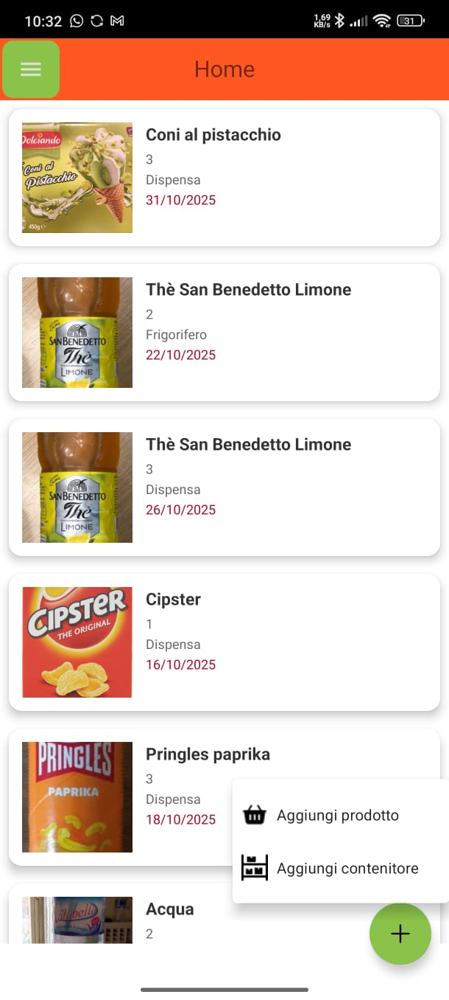
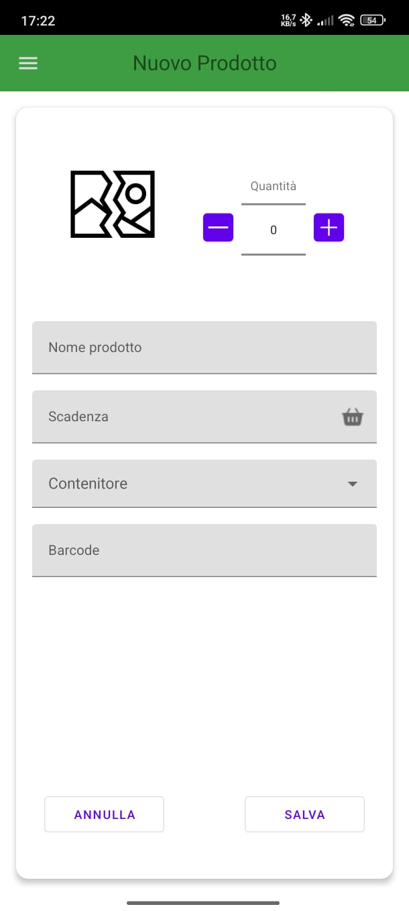
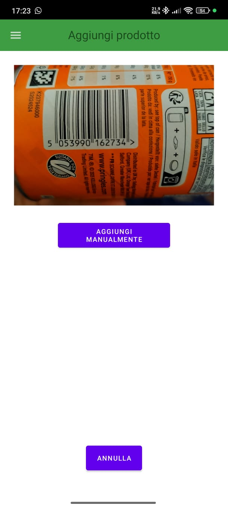

# 🥑 Pantry - Smart Kitchen Inventory Manager

## 📱 Project Overview
**Pantry** is a native Android application designed to minimize food waste and organize kitchen inventory efficiently.
Started as a **Bachelor's Thesis in Computer Engineering**, it is now being developed further towards a production-ready app with a dedicated backend.

The app allows users to create virtual containers (e.g., Fridge, Freezer, Pantry) and track products, specifically focusing on expiration dates to notify users before food goes bad.

## ✨ Key Features

### 📦 Inventory Management
* **Custom Containers:** Users can create, edit, and delete storage locations (e.g., "Kitchen Cabinet", "Basement Freezer").
* **Product CRUD:** Full control to add, modify, or remove items within specific containers.

### 🔍 Smart Entry System
* **Barcode Scanner:** Integration with the device camera to scan product barcodes.
* **OpenFoodFacts API:** Automatically fetches product details (name, brand, image) from the open database upon scanning.
* **Offline-friendly:** Products saved without a connection are stored immediately; their image is fetched in the background as soon as the network is back.
* **Manual Entry:** Fallback mode for products without barcodes.

### ⏰ Expiration Tracking
* **Priority Sorting:** Visual list of items sorted by expiration date (Ascending).
* **Smart Notifications:** Automated local push notifications alert the user when a product is approaching its expiration date.

## 🛠 Tech Stack & Architecture

This project is built using **modern Android development practices**:

* **Language:** Kotlin
* **User Interface:** Android Views (XML) with Fragments and Material Components
* **Local Database:** **Room** (SQLite abstraction layer) for offline-first data persistence.
* **Data model:** client-generated **UUID** ids, **soft delete**, and `created_at` / `updated_at` timestamps on every record, designed to support multi-device synchronization
* **Network:** OkHttp for the **OpenFoodFacts API**, Glide for image loading
* **Background work:** WorkManager (daily expiry check, fetching of missing product images)
* **Async Operations:** Kotlin Coroutines.
* **Hardware Integration:** CameraX / Barcode Scanning library.

## 🚧 Roadmap & Future Improvements
As a thesis prototype, the current version focuses on core functionality and local storage. The following features are planned for future releases to make the app production-ready:

* [x] **Data model for sync:** UUIDs, soft delete and household support in the local database
* [ ] **Backend:** Spring Boot + PostgreSQL REST API (Flyway migrations, JWT authentication, OpenAPI documentation, Docker Compose)
* [ ] **Cloud Synchronization:** offline-first sync between the app and the backend
* [ ] **Households & sharing:** shared pantries across multiple users, with a user able to belong to several households
* [ ] **UI/UX redesign:** new design with custom themes and animations (possibly migrating to Jetpack Compose)
* [ ] **User Settings:** customize notification timing (e.g., "Notify me 3 days before")
* [ ] **Recipe Suggestions:** integration with recipe APIs based on available ingredients

## 📷 Screenshots

    
    
    

## 👤 Author
**Luca Rizzo**
Computer Engineering Graduate
* [LinkedIn] https://www.linkedin.com/in/luca-rizzo-274367199/

---
*Started for academic purposes at Universitas Mercatorum.*
